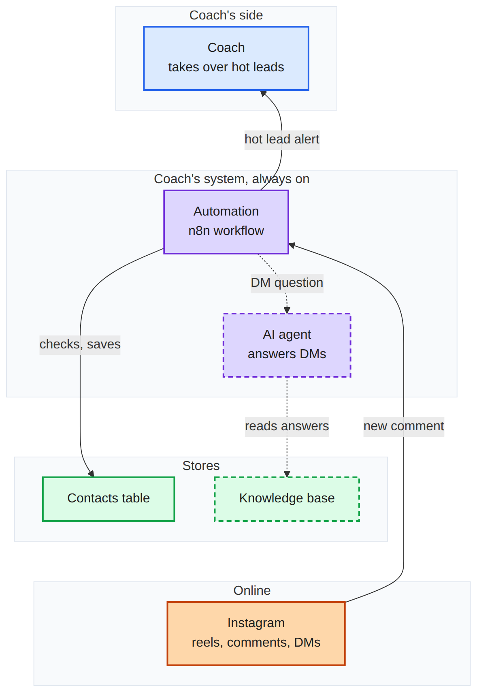

# system-blueprint

An agent skill (Claude Code, Codex and other `SKILL.md` agents) for **planning a system in
pictures instead of documents**, level by level, until there are no holes.

1. **The simple version**: the whole system as one map, every part placed by who owns it,
   including what is not built yet.
2. **Ask, one at a time**: every assumption is a yellow guess numbered in the order it is
   asked, each with a proposed answer.
3. **Go deeper**: the next level grows under the last in the same top-to-bottom picture,
   every part opened up with its steps. It ends as the simple version plus the full system.
4. **Built, next, later**: solid, dashed and grey, so it is clear what gets built now.
5. **Find the holes**: rounds over every step, failure, hand-off and store until a round
   finds nothing new. Then a build plan straight from the picture.

It is the process that worked when a non-technical owner planned a real two-person system
end to end, written down so the next system goes faster.

## Example: Instagram comment-to-DM system

The simple version, as Mermaid for a chat or a board:



The whole picture: the simple version, then the full system with numbered guesses:


Plan: [`examples/instagram-plan.json`](examples/instagram-plan.json). Open the
`.excalidraw` file at [excalidraw.com](https://excalidraw.com) to look around or edit it.

## Install

```bash
git clone https://github.com/Pu11en/system-blueprint ~/.claude/skills/system-blueprint
# or: ~/.agents/skills/system-blueprint, ~/.codex/skills/system-blueprint
```

Then ask your agent: *"Use system-blueprint to plan my <idea> system."*

Requirements: Python 3.10+ for `scripts/plan.py` (standard library only).
For PNG rendering: [uv](https://docs.astral.sh/uv/), then once:
`uv run --with playwright playwright install chromium`.

## Use the scripts directly

```bash
python3 scripts/plan.py examples/instagram-plan.json      # -> .excalidraw and .md
uv run scripts/render.py examples/instagram-plan.excalidraw
uv run scripts/render.py examples/instagram-plan.md
```

## Credits

Rendering uses [Excalidraw](https://github.com/excalidraw/excalidraw) and
[Mermaid](https://mermaid.js.org). The hole checklist borrows from service blueprints
(Nielsen Norman Group), BPMN and the "grill me" interview skills.

## License

MIT
