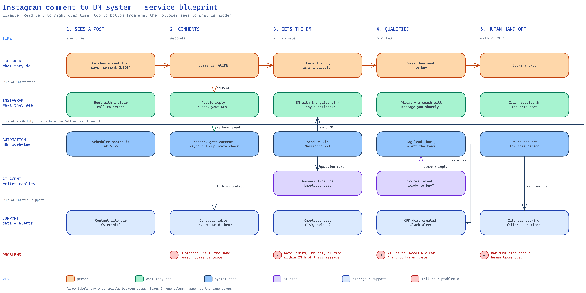

# system-blueprint

An agent skill (Claude Code, Codex and other `SKILL.md` agents) for designing automation and
business systems **without vague parts**, then drawing them the way professional system
designers do.

1. **Interview**: one question at a time, multiple choice with a recommendation, using a
   fixed step checklist: trigger, input, action, tool, output, failure, human hand-off.
   Answers go into a design log after every reply, with numbered open questions.
2. **Draw**: Excalidraw diagrams in two professional styles:
   - a **service blueprint** of the whole system: stages over time, from what people see
     down to what is hidden;
   - **BPMN-style flows**: the normal path in a straight line, with every failure, retry and
     dead end branching off.

## Example: Instagram comment-to-DM system




Specs: [`examples/instagram-blueprint.json`](examples/instagram-blueprint.json),
[`examples/instagram-flow.json`](examples/instagram-flow.json). Open the `.excalidraw`
files at [excalidraw.com](https://excalidraw.com) to edit them.

## Install

```bash
git clone https://github.com/Pu11en/system-blueprint ~/.claude/skills/system-blueprint
# or: ~/.agents/skills/system-blueprint, ~/.codex/skills/system-blueprint
```

Then ask your agent: *"Use system-blueprint to design my <idea> system."*

Requirements: Python 3.10+ for `scripts/diagram.py` (standard library only).
For PNG rendering: [uv](https://docs.astral.sh/uv/), then once:
`uv run --with playwright playwright install chromium`.

## Use the scripts directly

```bash
python3 scripts/diagram.py blueprint examples/instagram-blueprint.json
python3 scripts/diagram.py flow examples/instagram-flow.json
uv run scripts/render.py examples/instagram-flow.excalidraw
```

## Credits

Diagram conventions come from the [C4 model](https://c4model.com) (Simon Brown),
[service blueprints](https://www.nngroup.com/articles/service-blueprints-definition/)
(Nielsen Norman Group) and [BPMN](https://www.omg.org/bpmn/). Rendering uses
[Excalidraw](https://github.com/excalidraw/excalidraw). Inspired by the
[excalidraw-diagram-skill](https://github.com/coleam00/excalidraw-diagram-skill) and the
"grill me" interview skills.

## License

MIT
