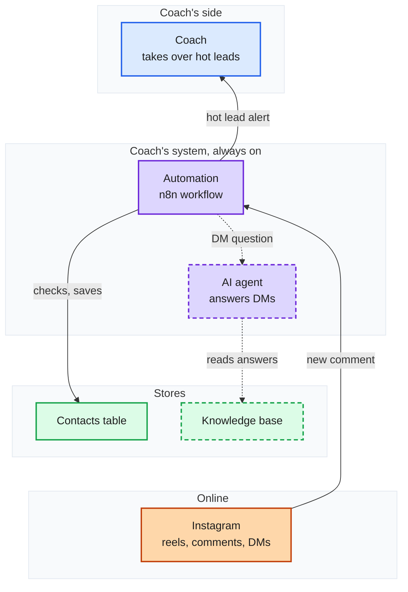

# Instagram comment-to-DM system

Colour = who does it: Coach, Coach's system, Stores, Instagram and followers. Solid: built and working. Dashed: the next build. Grey: later, not in this build. Yellow with a number: a guess; the number is the question that settles it.

## The simple version

## Questions only the coach can answer

1. Which words make someone a hot lead?
2. May the system DM people who never commented?

## The full system, step by step

In the drawing `instagram-plan.excalidraw`, under the simple version.
